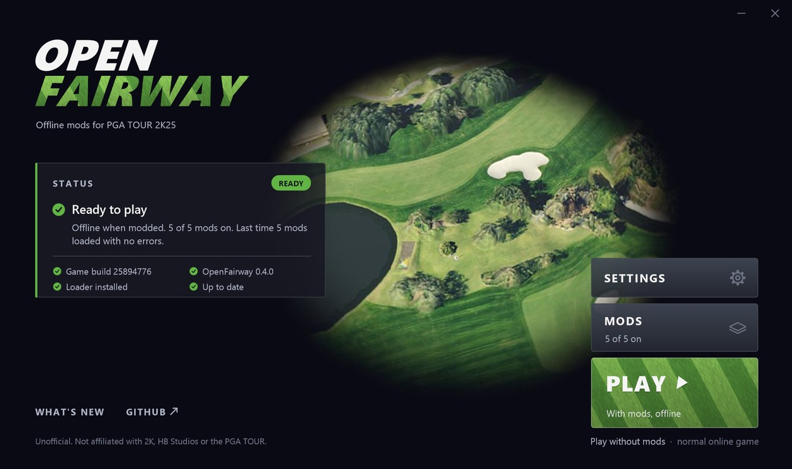
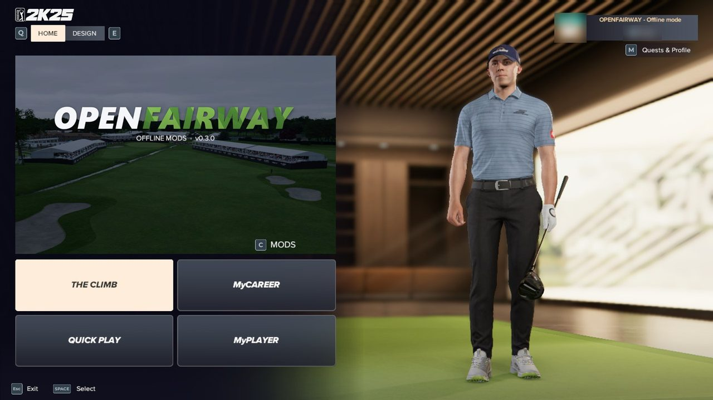
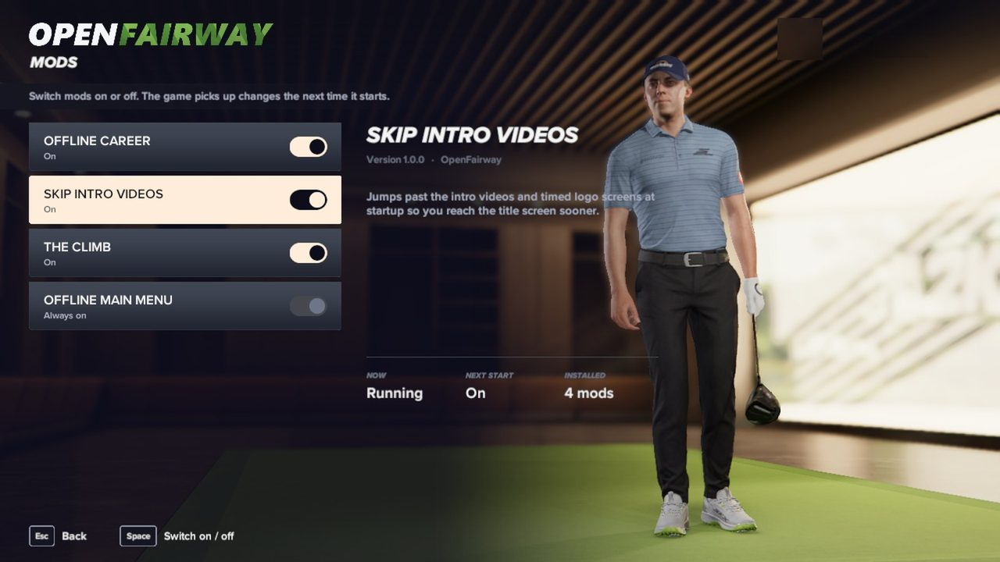
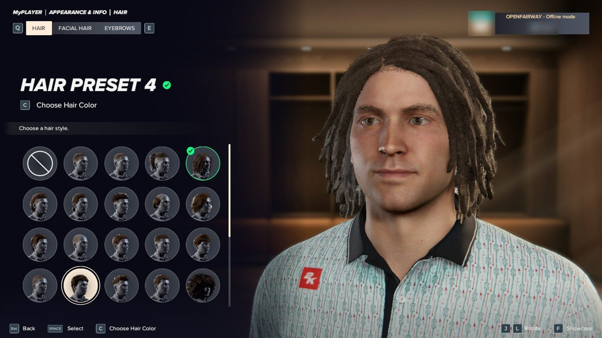
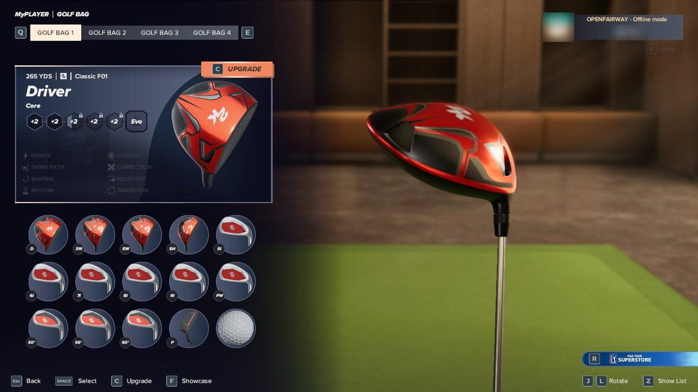
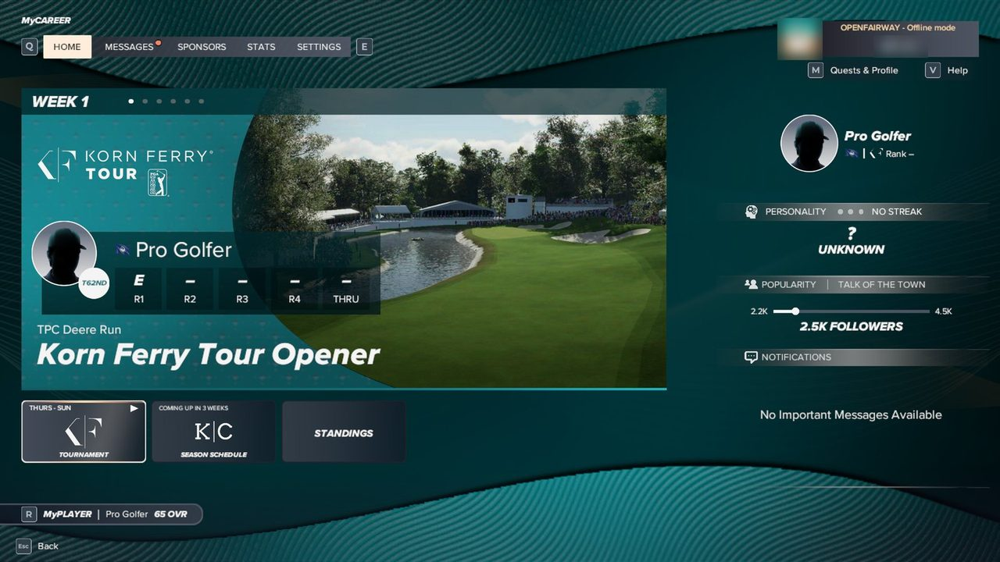
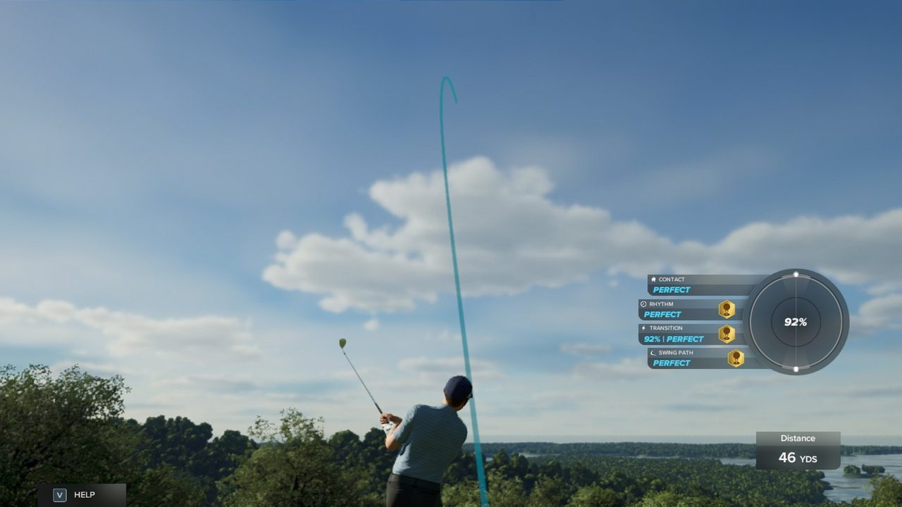
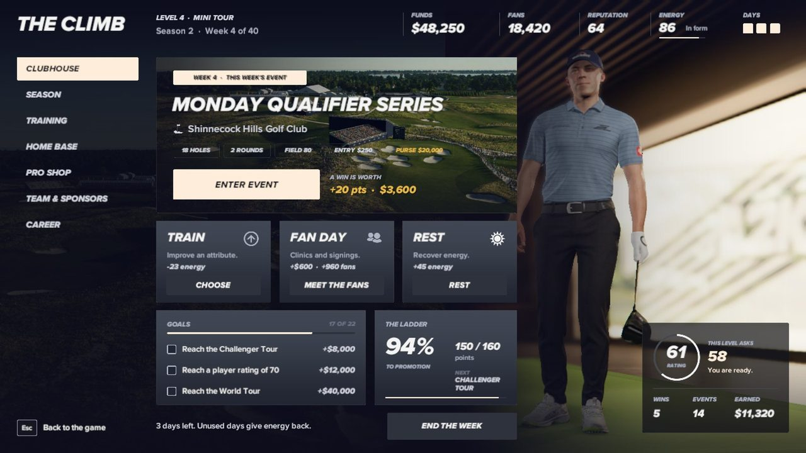
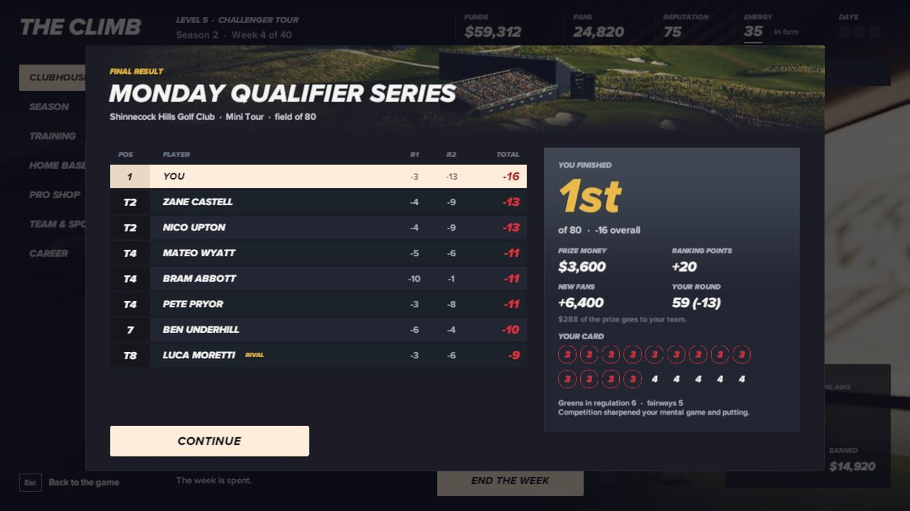

<p align="center"></p>

<p align="center"><b>Offline play and mods for PGA TOUR 2K25</b><br>
MyPLAYER, MyCAREER, Quick Play and every course without 2K's servers, plus a C# modding platform and a new career mode.</p>

<p align="center">
<a href="https://github.com/xk0fe/pga2k25-openfairway/releases/latest">Download</a> ·
<a href="https://xk0fe.github.io/pga2k25-openfairway/">Modding guide and API</a> ·
<a href="examples">Example mods</a> ·
<a href="CHANGELOG.md">Changelog</a>
</p>

<p align="center"></p>

An unofficial, community-made project. It is not affiliated with, endorsed by or connected to 2K, HB Studios or the
PGA TOUR. It runs inside your own copy of the game, offline only, and unlocks nothing that is sold.

## What you get

| | |
|---|---|
|  |  |
| **Offline main menu.** The game boots straight into an offline menu that only shows what works offline. | **Mods, switched in game.** A mod manager in the game's own style, and the same switches in the launcher. |
|  |  |
| **MyPLAYER offline.** Create and edit your golfer: appearance, hair, outfits, golf bag. | **Clubs level up offline.** Rounds you play award club, ball and golfer XP; each club level unlocks an upgrade. |
|  |  |
| **MyCAREER offline.** The game's own career with a local save. | **Every course.** Quick Play on all the courses that ship with the game. |
|  |  |
| **The Climb.** A new story career with management: from club amateur with a day job to the World Tour. | **Play the big rounds yourself.** Events are simulated from your golfer; you play the final round. |

## Install

1. Download `OpenFairway-<version>.zip` from [Releases](https://github.com/xk0fe/pga2k25-openfairway/releases/latest) and unzip it anywhere.
2. Double-click **Install OpenFairway.cmd**. It finds the game through Steam by itself.
3. Open **OpenFairway** from your desktop and press **Play**. Mods, Settings and What's new are beside it.

Nothing to pre-install, no firewall rule, no admin rights.

- **Play** starts the game through Steam with the loader on for that one launch, confirms that OpenFairway loaded
  inside the game, and steps aside until you close it. The game process is cut off from the network from the
  inside, so it always runs offline.
- **Play without mods**, or starting the game from Steam as usual, gives the normal, unmodified online game.
- **Uninstall OpenFairway.cmd** removes everything the installer added.

## The launcher

- **Status.** One card says whether you can play, and if not, why and what to do: the game's Steam build, the
  loader, the OpenFairway version and updates. After Play it follows the start, confirms that OpenFairway loaded
  inside the game, and comes back when the game closes with how the session went. When something stops it, it says
  so plainly, with Retry, the logs, and a report to copy into an issue.
- **Updates.** When a newer release is on GitHub, Play becomes Update. The download is checked against the SHA-256
  GitHub lists for it and installed by the release's own installer; your mods, settings and saves stay.
- **Mods.** Switch mods on and off, open one for its full description, what it needs and how it did last time, or
  drop a mod's `.zip` on the window to install it.
- **What's new** shows the release notes of every version. **Settings** has the launcher's behaviour, update checks,
  the key that opens the mod manager in game (F8), launch options for the game, a Steam file check, and switches for
  mod makers (detailed log, developer console).

The launcher contacts GitHub, and only GitHub, to look for updates and read release notes; nothing about you is
sent, and Settings can switch it off. The game itself always runs offline with mods.

## The mods

| Mod | What it does |
|---|---|
| Offline Main Menu | The offline main menu, the OpenFairway banner and the in-game mod manager (F8). |
| Offline Career | The game's MyCAREER and MyPLAYER offline, with a local golfer and save. |
| Offline Progression | Rounds played offline give the club, ball and golfer XP 2K's servers would. 3x pace by default (`mods\OfflineProgression\data\settings.json`). |
| The Climb | A management career mode built on custom screens. |
| Skip Intro Videos | Gets you to the title screen in seconds. |

## How it works

```
Steam starts the unmodified game
  └─ version.dll (Unity Doorstop, added next to the exe) starts .NET 8 inside the game process
       └─ OpenFairway.Core.dll
            ├─ offline guard        cuts the game process off from 2K's servers, or stays inactive
            ├─ IL2CPP bindings      the il2cpp_* exports of the running game (classes, fields, methods, invoke)
            ├─ type dumper          writes OpenFairway\dump\*.cs (signatures only) for mod development
            └─ mod loader           OpenFairway\mods\<Name>\<Name>.dll implementing IFairwayMod
```

## Writing mods

Mods are C# libraries for .NET 8: one DLL plus a `mod.json`. The API gives you the game's own menus and popups,
full custom screens drawn in the game's fonts, the course list, and direct access to game objects.

```csharp
public sealed class HelloBanner : IFairwayMod
{
    public string Id => "example.hellobanner";

    public void OnLoad(IModContext ctx)
    {
        ctx.Ui.MainMenu.SetBanner(new MenuBanner
        {
            Title = "HELLO",
            OnClick = () => ctx.Ui.ShowNotice("HELLO", "This popup comes from a mod."),
        });
    }
}
```

The **[modding guide and API reference](https://xk0fe.github.io/pga2k25-openfairway/)** (also in
[`docs/index.html`](docs/index.html)) walks through menus, custom screens, courses, saving data and game objects, with
the four [example mods](examples) as working code.

## Building from source

Needs the .NET 8 SDK on Windows.

```
tools\package.ps1
```

builds the platform, the mods and the launcher, downloads the Unity Doorstop loader, and assembles
`dist\OpenFairway` (about 80 MB: it bundles the .NET 8 runtime). `tools\dev-cycle.ps1` is the developer loop: it
deploys the build into the game, starts it in a small window and enables the developer console
(`tools\devcon.py`). The game is found through Steam, or set `OPENFAIRWAY_GAME` to its folder.

| Folder | Holds |
|---|---|
| `src/OpenFairway.API` | The mod API (`Api.cs`) |
| `src/OpenFairway.Core` | The platform: loader, offline guard, runtime bridge, game UI, custom screens |
| `src/OpenFairway.Launcher` | The launcher (.NET Framework 4.8, ships with Windows) |
| `mods/` | The mods above |
| `examples/` | Example mods for the guide |
| `installer/` | Install and uninstall scripts |
| `docs/` | The modding guide (`tools/make-docs.py`) and the design language (`design.md`) |
| `tools/` | Packaging, the developer loop, and the generators for the wordmark, banner and the launcher's 3D hole |

## Ground rules

These are design constraints, not suggestions.

1. **Memory only.** No game file is ever modified, replaced or redistributed. The installer only *adds* files, and
   the uninstaller removes exactly those.
2. **No protection is touched.** The game's licence check, Steam wrapper and anti-tamper stay intact and must pass
   normally. Parts of the game binary are encrypted on disk; OpenFairway does not decrypt, dump or unpack them. It
   talks to the game solely through the runtime API the game itself exports.
3. **Offline only.** Whenever the platform is active it first blocks the game process's own name resolution and
   verifies the official hosts no longer resolve; if that fails it stays inactive. Mods never run in ranked,
   matchmaking or any official online mode.
4. **Nothing paid is unlocked.** No currency, store items, passes or DLC. Mods that do this are out of scope and
   will not be accepted.
5. **Original code only.** This repository contains no game code, assets, decompiled output or server files. The
   local type dump the platform generates is for your own development and is never committed.

Using mods may still breach the game's terms of service and can put an online account at risk. Use it offline, at
your own risk. Nothing here is legal advice. PGA TOUR, 2K and the game's names and images belong to their owners;
screenshots show the game running with OpenFairway.

## Licence

OpenFairway is released under the [MIT licence](LICENSE). The release package also contains Unity Doorstop
(LGPL-2.1) and the .NET runtime (MIT); see [THIRD-PARTY-NOTICES.md](THIRD-PARTY-NOTICES.md).
